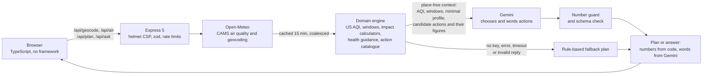

# Clearday

Clearday is an urban air quality assistant for families and communities, built for the
PromptWars "Urban Air Quality Assistant" challenge. Search any city in the world, or use your
location, and it shows the live US Air Quality Index, the next 48 hours hour by hour, and a plan
for your household in three parts: a low-emission daily routine, indoor air hacks and sustainable
swaps. Each recommendation explains its impact, and where a cited calculation exists it shows a
number (kg CO₂e a year, % change in PM2.5 inhaled, % less PM2.5 indoors) that opens to its formula,
inputs, assumptions and sources. Google Gemini picks and words the advice. Every number comes from
tested TypeScript, never from the model. You can also ask follow-up questions about today's air.

It feels like an app, not a long page. Five screens (Today, Forecast, My plan, Ask and How it
works) each have their own address, so Back, refresh and shared links work. A floating tab bar on
phones becomes a row of pills on wider screens. Puff, a cloud mascot, greets you and reacts to the
air honestly. He grins on a good day, wears a mask once the air is unhealthy, and stays indoors
when it is worse. What he says comes from a fixed table in the code, never from the AI. Families
can tick off the day's routine steps, and Puff cheers when they are all done.

## How it meets the brief

> Create a GenAI-powered assistant that helps families and communities navigate severe winter
> smog and urban air pollution. The application should suggest low-emission daily routines,
> indoor air quality hacks, and sustainable alternatives tailored to their location and
> lifestyle, while clearly explaining the direct impact of their choices.

| Phrase in the brief                                   | What Clearday does                                                                                                                                                                                                                                                                                                     | Where                                                                                                      |
| ----------------------------------------------------- | ---------------------------------------------------------------------------------------------------------------------------------------------------------------------------------------------------------------------------------------------------------------------------------------------------------------------- | ---------------------------------------------------------------------------------------------------------- |
| GenAI-powered assistant                               | Gemini chooses and orders the day's actions from a pre-filtered catalogue, writes a "why this matters for you" for each one and a day summary, and answers follow-up questions. It returns structured JSON that must match a response schema.                                                                          | `server/src/services/planService.ts`, `askService.ts`, `gemini.ts`, `web/src/components/askPanel.ts`       |
| helps families and communities                        | The household profile records adults, children under 12, adults over 65, pregnancy, and lung or heart conditions. Sensitive households get extra EPA/AirNow health lines and child-specific actions such as timing the school run. One action asks people to share what they have learned with their street or school. | `web/src/components/profileForm.ts`, `server/src/domain/health.ts`, `server/src/domain/catalog.ts`         |
| navigate severe winter smog and urban air pollution   | Live US AQI from PM2.5, PM10, ozone and NO₂, a 48-hour bar chart with the cleanest daytime and the worst two-hour windows, a table view, and a daily outlook. The AQI is not capped at 500, so very severe smog reads as it really is.                                                                                 | `server/src/domain/aqi.ts`, `report.ts`, `windows.ts`, `web/src/components/aqiCard.ts`, `forecastChart.ts` |
| low-emission daily routines                           | A "low-emission routine" section: move or re-time exercise to the cleanest window, keep errands out of the smoggiest hours, leave for the school run an hour earlier or later when that hour is cleaner, wear an N95/FFP2 outdoors. A time on another day says "Tomorrow" or the weekday.                              | `server/src/domain/catalog.ts` (section `routine`), `planner.ts`                                           |
| indoor air quality hacks                              | An "Indoor air" section: keep windows shut while the air is bad, run a purifier, build a box-fan cleaner, set up one clean room, vent while cooking, air out at the cleanest hour.                                                                                                                                     | `catalog.ts` (section `indoor`), `server/src/domain/impact/indoor.ts`                                      |
| sustainable alternatives                              | A "Greener swaps" section: switch commute mode, never burn waste, cleaner cooking and heating fuels, combine trips, share rides.                                                                                                                                                                                       | `catalog.ts` (section `sustainable`), `server/src/domain/impact/commute.ts`                                |
| tailored to their location                            | Air, forecast windows and local times are for the chosen coordinates and time zone. The country sets the grid carbon intensity used for electric cars and rail (213 countries plus a world average).                                                                                                                   | `server/src/services/openMeteo.ts`, `server/src/domain/data/gridIntensity.json`                            |
| and lifestyle                                         | The commute mode, distance and departure hour, exercise type, time and length, heating and cooking fuel, purifier, windows and indoor smoking decide which of the 25 catalogue actions apply and feed the impact calculators.                                                                                          | `shared/types.ts` (`Profile`), `catalog.ts` (`applies`, `impact`)                                          |
| clearly explaining the direct impact of their choices | Every item has a plain-language "why". Items with a cited calculation carry an impact chip, such as "≈710 kg CO₂e/yr saved" or "−35% PM2.5 indoors vs outdoors", that opens "How we calculated this" with the formula, each input, each assumption and the sources.                                                    | `server/src/domain/impact/*.ts`, `web/src/components/impactChip.ts`, `planView.ts`                         |

## Architecture



- `server/src/app.ts` builds the Express app from injected services and reads no environment
  variables. `server/src/index.ts` wires in the real ones from `config.ts`.
- `server/src/domain/` is pure, deterministic code: AQI, windows, the impact calculators, health
  guidance, the action catalogue, the planner, the number guard and the profile minimiser.
- `server/src/services/` holds the outside world: Open-Meteo with its cache, Gemini, and the plan
  and ask services that join the domain to the model.
- `web/` is a small app bundled by Vite, with a hash router (`web/src/router.ts`) that shows one
  screen at a time. It builds all DOM through `h()` in `web/src/dom.ts`, never through
  `innerHTML`, and draws the chart and Puff (`components/mascot.ts`) as SVG by hand. Express
  serves the built files.
- `shared/` holds the request and response types used by both sides.

## Accuracy

**Numbers from code, words from Gemini.** Gemini never originates a figure: every number on
screen is computed in code first, and the model may only repeat numbers it was given.

- The AQI, the windows, the times and every impact figure are computed in `server/src/domain/`.
- Gemini only returns action ids and prose. Unknown and duplicate ids are dropped.
- Item titles, sources, clock times and their day labels ("Tomorrow" or a weekday) always come
  from the catalogue and the windows, never from the model. Gemini is told each time's day and
  told not to call a time on another day "today".
- The number guard (`server/src/domain/numberGuard.ts`) checks every sentence Gemini writes
  (each "why", the summary and each Q&A answer). A sentence that contains a number not present
  in the context Gemini was given, or any non-ASCII digit, is discarded. A plan item then falls
  back to the catalogue's own explanation, and a Q&A answer becomes a fixed "couldn't answer
  reliably" message.
- If there is no API key, or Gemini errors, takes longer than 10 s or returns JSON that fails
  validation, the rule-based planner (`server/src/domain/planner.ts`) builds the same kind of plan
  from the catalogue, and the page says "AI summary unavailable — showing our standard plan."
  A question in the same situation (8 s limit) gets a fixed reply marked as a standard answer.
  A momentary server error from Google (HTTP 5xx) is retried once after 300 ms inside the same
  time limit; a 4xx such as a bad key, retired model or used-up quota is not retried.
- The guard is a safety net against invented figures, not a proof of correctness. Its known
  limits (number words, signs, which unit a number is attached to) are written down in
  `numberGuard.ts`.

**How the AQI is computed** (`server/src/domain/aqi.ts`).

- Clearday computes the US EPA AQI itself from hourly concentrations, rather than taking
  Open-Meteo's `us_aqi` field on trust.
- It uses the breakpoint tables of the EPA Technical Assistance Document (2024), including the
  2024 PM2.5 breakpoints. Concentrations are truncated to the EPA reporting precision before
  Equation 1 is applied.
- PM2.5 and PM10 use the EPA NowCast for each hour, as EPA AirNow does: a weighted mean of the
  last 12 hours with weight factor w = 1 − (max − min) ÷ max (at least 0.5), needing 2 of the 3
  most recent hours. It is read against the 24-hour breakpoints, so the 48-hour chart and the
  cleanest and worst windows follow the daily smog cycle. Ozone uses the higher of the trailing
  8-hour mean (at least 6 valid hours) and the 1-hour value. NO₂ uses the 1-hour value.
- Ozone and NO₂ are converted from µg/m³ to ppb at 25 °C and 1 atm (`units.ts`).
- Above 500 the top segment is extended, as footnote 4 of the EPA document directs, so a 24-hour
  PM2.5 of 600 µg/m³ reads as 1047 rather than being clipped.
- The "now" figure is an hourly estimate built from the NowCast and trailing averages, and the
  page says so.
- The tests cover the breakpoints, truncation, the EPA's ozone worked examples and every
  category boundary (`tests/server/domain/aqi.test.ts`).

**Where the impact figures come from.** Each constant sits in the code next to the table, row or
cell it was taken from.

| Figure                                                                                              | Formula                                                                | Source                                                                                                                                                                                                                                                                                                                |
| --------------------------------------------------------------------------------------------------- | ---------------------------------------------------------------------- | --------------------------------------------------------------------------------------------------------------------------------------------------------------------------------------------------------------------------------------------------------------------------------------------------------------------- |
| Commute CO₂e saved per year (`impact/commute.ts`)                                                   | one-way km × 2 trips × 5 days × 46 weeks × (kg CO₂e/km before − after) | Fuel modes: UK DESNZ GHG Conversion Factors 2026, tailpipe plus well-to-tank. Electric car and rail: DESNZ kWh per km × the country's lifecycle grid intensity from Our World in Data, based on Ember (CC BY 4.0). Bus and rail are per passenger-km at UK average occupancy (the DESNZ basis), and the chip says so. |
| % change in PM2.5 inhaled (`impact/exposure.ts`)                                                    | concentration × inhalation rate × minutes, before and after            | US EPA Exposure Factors Handbook 2011, chapter 6, Table 6-2 (mean short-term inhalation rates by age and activity); the school run compares PM2.5 at the hour either side of departure, where rate and minutes cancel                                                                                                 |
| % less indoor PM2.5 with a purifier, and indoors vs outdoors with windows shut (`impact/indoor.ts`) | steady-state mass balance C_in = P·a·C_out / (a + k + CADR/V)          | Xiang et al. 2021 (air exchange 0.53/h, deposition 0.26/h, penetration 0.97); default room and purifier size from the US EPA Guide to Air Cleaners in the Home                                                                                                                                                        |
| Health advice per AQI category (`health.ts`)                                                        | static table, with extra lines for sensitive groups                    | AirNow, Air Quality Guide for Particle Pollution                                                                                                                                                                                                                                                                      |

Actions with no solid cited figure, such as not burning waste or not smoking indoors, explain
their impact in words only and link to EPA or WHO pages (`server/src/domain/guidanceSources.ts`).
No number is better than a shaky one. Air data comes from Open-Meteo (CC BY 4.0), based on
Copernicus Atmosphere Monitoring Service (CAMS) forecasts. The page's "How we calculate" section
lists the same sources for users.

## Security

The `GEMINI_API_KEY` is read only on the server (`server/src/config.ts`) and never reaches the
browser. `server/src/middleware/security.ts` sets a strict Content-Security-Policy with helmet:
`'self'` only, no inline scripts or styles, `frame-ancestors 'none'`. ESLint forbids `innerHTML`,
`outerHTML`, `insertAdjacentHTML` and `style` attributes in `web/` (`eslint.config.js`), so model
and user text is only ever rendered as text. Every request is validated by zod schemas with
ranges, enums and length caps (`server/src/schemas.ts`): request bodies reject unknown keys,
questions are at most 500 characters, and JSON bodies are capped at 10 kb. Validation errors
report field paths only, never the values. Rate limits per IP: 20 requests per 10 minutes for the
Gemini-backed `/api/plan` and `/api/ask`, and 120 per 10 minutes across `/api`. `TRUST_PROXY` is a
hop count (default 0), so `X-Forwarded-For` cannot be spoofed to dodge the limiter unless you
deploy behind that many proxies.

- **Gemini sees little personal data.** It gets a place-free context: no coordinates, no city name
  and no hourly series. The profile is reduced to coarse flags (`server/src/domain/minimalProfile.ts`).
- **Prompt injection is contained.** User text travels inside delimited `<question>` blocks with
  angle brackets stripped, and the system rules tell the model to treat it as data
  (`server/src/services/aiContext.ts`, `askService.ts`).
- **Upstream data is checked.** Open-Meteo responses are schema-checked and every outbound fetch
  has an 8 s timeout (`server/src/services/openMeteo.ts`).
- **Errors and logs leak nothing.** Errors map to short JSON codes, and only the error's name is
  logged, never a stack trace, a profile or a question (`server/src/middleware/errors.ts`). A
  failed Gemini call logs one `gemini_failed` line with the error's name and HTTP status, so a bad
  key, quota or model id is visible on the server (`server/src/services/gemini.ts`).
- **The profile stays in the browser.** It lives in `localStorage` and is never stored on the
  server. Coordinates are rounded to 2 decimals before they leave the browser.
- **The profile form says what is shared.** A notice explains that the Gemini free tier may use
  prompts to improve Google products. The Q&A box says that typed questions are sent to Google
  Gemini, whose free tier may use them to improve Google products, and asks people not to include
  personal details.

## Efficiency

- **Small bundle, no framework.** There is no frontend framework, chart library or UI kit. The
  production JavaScript is 53 kB, about 19.7 kB gzipped, and the CSS is about 9.6 kB gzipped
  (`npm run build`). The one font, Nunito, is a single 39 kB Latin woff2 served from the app
  itself. The server has six runtime dependencies.
- **Caching with request coalescing.** Air reports are cached in memory for 15 minutes per 0.1°
  grid cell and place searches for 24 hours. Concurrent requests for the same key share one
  upstream fetch, and the cache is bounded at 500 entries (`server/src/services/cache.ts`).
- **One Gemini call per plan.** The browser keeps a plan for the same place, profile and local hour
  (`web/src/main.ts`), so going back to a place does not call Gemini again.
- **Compressed, long-lived assets.** Responses are compressed. Hashed assets are served with a
  one-year `immutable` cache header and the HTML shell with `no-cache` (`server/src/app.ts`).

## Accessibility

Clearday targets WCAG 2.2 AA:

- **Page structure.** A skip link, landmarks, a main navigation of plain links that marks the
  current screen with `aria-current="page"`, one `h1` per screen and labelled sections. Moving
  to another screen moves focus to its heading and updates the page title.
- **City search.** It follows the ARIA 1.2 combobox pattern (`locationSearch.ts`).
- **Household form.** A modal dialog that moves focus to each step's heading, closes on Escape
  and returns focus to where it came from (`profileForm.ts`).
- **Impact chips.** Disclosure buttons with `aria-expanded`; Escape closes the panel.
- **Live announcements.** A polite live region announces loaded air, plans and answers.
- **Not colour alone.** The AQI is a number, a text category and a colour. The chart has a text
  description, labelled cleanest daytime and worst windows, and a data table you can toggle.
  Every bar has a neutral outline that reaches 3:1 against the card, so even the pale Good and
  Moderate bars stay visible (WCAG 1.4.11).
- **Visible focus and touch targets.** Focus rings are a visible 3 px. Buttons, impact chips and
  form fields are at least 40 px tall, well above the 24 px WCAG 2.2 minimum.
- **One bright theme, checked for contrast.** A sky gradient fades into warm cream under white
  cards. On the sky, all text uses the dark body colour (at least 7.9:1 on every sky tint;
  `tests/styles/tokens.test.ts` checks each one). Teal links, white text on teal and sunny
  buttons with dark text all reach AA. The six EPA colours are never used as text.
- **Display preferences.** Every decorative animation (screen changes, Puff's float and blink,
  cards popping in, the confetti) sits in one `prefers-reduced-motion: no-preference` block in
  `web/src/styles/motion.css`, and a test keeps it that way. Nothing flashes. The layout works
  from 320 px wide.
- **Puff is decoration.** His SVG is `aria-hidden`; what he says is real text, and emoji beside
  it are hidden from screen readers. The plan's Done boxes are labelled "Done: <step>", and
  finishing the routine is announced once.
- **Location errors say how to fix them.** If "Use my location" fails, the message says whether
  access is blocked (with a pointer to site settings), the position is unavailable, or the request
  timed out.
- **Automated checks.** `tests/web/a11y.test.ts` renders the real page with fixture data in jsdom
  and runs axe-core with the `wcag2a`, `wcag2aa`, `wcag21aa` and `wcag22aa` tags. It covers the
  five screens before a place is chosen and again with one loaded, the reopened search, the
  full report with the table open, an open impact panel, every step of the household dialog,
  the first-visit dialog and an answered question, and expects zero violations. Colour contrast
  and target size need a real layout engine, so those two rules are run in a real browser
  instead.

  After the redesign, axe-core ran in Chromium on all five screens, with and without a place,
  at 320 px, 375 px and desktop width, with every rule on (contrast and target size included).
  It found zero violations.

  Before the redesign, a browser pass (Chromium, at 320 px, 375 px and desktop width, with the dialog, the
  table and every impact panel open) found zero violations, including contrast. Where axe could
  not judge contrast on its own (text over the AQI card's colour stripe, or rows scrolled out of
  the table's view), the ratio was measured directly. After the switch to the bright theme, every
  visible text element on a full report (164 of them, band included) was measured again in
  Chromium, and all reach WCAG AA.

## Testing

```
npm run test:coverage   # 659 tests in 44 files; 97.0% statements, 98.4% lines, 91.0% branches
```

Vitest runs three projects (`vitest.config.ts`): `server` in Node (297 tests), `web` in jsdom
(351 tests) and `styles` (11 tests), which reads the stylesheets to check the palette's contrast
and that every animation respects reduced motion. CI fails if line coverage drops below 80%.

- **Domain.** The AQI, unit conversion, windows, every impact calculator against hand-checked
  values, health guidance, catalogue filtering, the planner, the number guard and the profile
  minimiser (`tests/server/domain/`).
- **Services.** The cache, Open-Meteo parsing and errors, the Gemini adapter, and the plan and ask
  services, including fallback, timeout and guard rejections (`tests/server/services/`).
- **API (Supertest).** Each route's happy path, validation, the 10 kb limit, rate limits, proxy
  trust, error mapping, the exact CSP, caching headers, and that questions are never logged
  (`tests/server/app.test.ts`).
- **Web.** Every component, the router (deep links, Back, focus and titles), Puff's mood and words
  per category, Today's cards, the routine checklist (kept per place and day, reset the next
  day, celebrated once), the app's boot, place-change and error flows, plus the axe checks
  (`tests/web/`).
- **No network.** `fetch` and Gemini are injected fakes. The Open-Meteo fixture is generated
  offline by `tests/fixtures/generateOpenMeteoAir.mjs`.

GitHub Actions (`.github/workflows/ci.yml`) runs `npm ci`, lint, typecheck, tests with coverage
and the production build on every push and pull request.

## Setup

You need Node 22 (see `.nvmrc`); Node 20.19 or newer also works.

1. Get a free Gemini API key from [Google AI Studio](https://aistudio.google.com/apikey).
   Clearday works without one too: it then shows the rule-based plan and says so.
2. Copy the example settings and put your key in `.env`:

   ```sh
   cp .env.example .env
   ```

3. Install and run:

   ```sh
   npm install
   npm run dev
   ```

   This starts the API on port 8080 and the Vite dev server, which proxies `/api` to it. Open the
   URL Vite prints, usually `http://localhost:5173`.

For a production build, run `npm run build`, then `npm start`, and open `http://localhost:8080`.

### Deploy

`render.yaml` describes one free [Render](https://render.com) web service: it runs `npm ci && npm
run build`, starts with `npm start`, checks `/healthz`, and sets `TRUST_PROXY=1` for Render's load
balancer. In Render, choose **New → Blueprint**, pick this repository, and paste your Gemini key
into `GEMINI_API_KEY` when asked; it stays in Render and never enters the repo. The free plan
sleeps after 15 idle minutes, so the first visit after that takes a little longer.

## Scripts

| Script                  | What it does                                                               |
| ----------------------- | -------------------------------------------------------------------------- |
| `npm run dev`           | API server with reload (`tsx watch`) and the Vite dev server together      |
| `npm run build`         | Compiles the server to `dist/server` and bundles the web app to `dist/web` |
| `npm start`             | Runs the built server, which also serves the built web app                 |
| `npm test`              | Runs all tests once                                                        |
| `npm run test:coverage` | Runs all tests with a coverage report and the 80% line threshold           |
| `npm run lint`          | ESLint over the whole repository                                           |
| `npm run typecheck`     | `tsc --noEmit` for the server and the web app (strict)                     |
| `npm run format`        | Prettier over the whole repository                                         |

## Configuration

All settings are environment variables, read only in `server/src/config.ts`. See `.env.example`.

| Variable         | Default                 | Meaning                                                                                                                                                                                            |
| ---------------- | ----------------------- | -------------------------------------------------------------------------------------------------------------------------------------------------------------------------------------------------- |
| `GEMINI_API_KEY` | empty                   | Google AI Studio key. Leave it empty to use the rule-based plan only.                                                                                                                              |
| `GEMINI_MODEL`   | `gemini-3.5-flash-lite` | Gemini model id. Pick a fast Flash-Lite model: plans give up after 10 s and questions after 8 s.                                                                                                   |
| `PORT`           | `8080`                  | HTTP port                                                                                                                                                                                          |
| `TRUST_PROXY`    | `0`                     | How many reverse-proxy hops sit in front of the app. Set it to `1` behind a single load balancer. Keep it `0` when clients connect directly; otherwise they can fake their IP to the rate limiter. |

## Limits

- **Modelled data, not sensors.** Air quality comes from the CAMS forecast models, at about 11 km
  resolution in Europe and about 40 km elsewhere. These are not readings from a street-level
  monitor and can miss very local sources such as a busy road, a nearby fire or a neighbour's
  stove.
- **Estimates under stated assumptions.** Impacts assume a typical home, body and vehicle, and
  each chip lists its assumptions:
  - 2 trips a day, 5 days a week, 46 weeks a year;
  - UK emission factors for fuel-burning vehicles;
  - one occupant per car;
  - closed-window air exchange from measured US homes;
  - a purifier sized to EPA's minimum when its CADR is unknown.
- **Yearly grid averages.** Grid carbon intensity is a national yearly average, and a few
  countries' latest figures are several years old (the year is shown).
- **Not medical advice.** Health text paraphrases public EPA/AirNow guidance. If you have symptoms
  or a health condition, follow your clinician's guidance.

## License

[MIT](LICENSE). The Nunito font (`web/src/assets/fonts/`) is © The Nunito Project Authors,
under the [SIL Open Font License 1.1](web/src/assets/fonts/OFL.txt).
